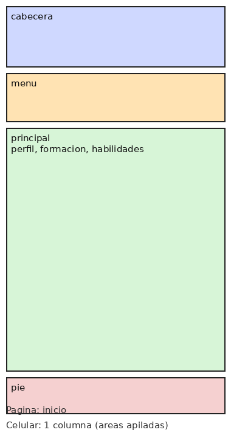
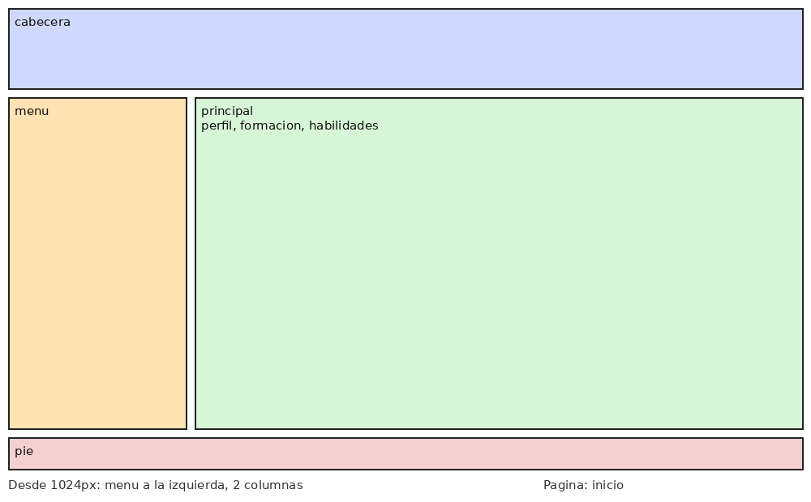
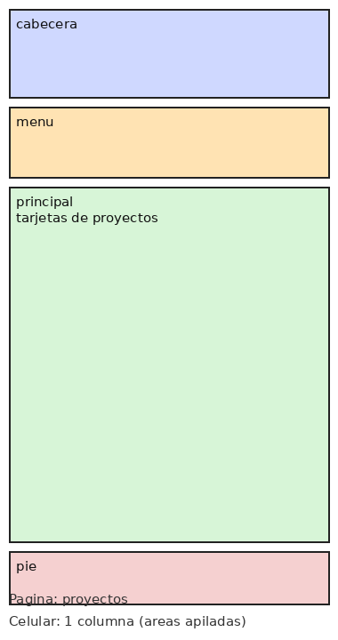
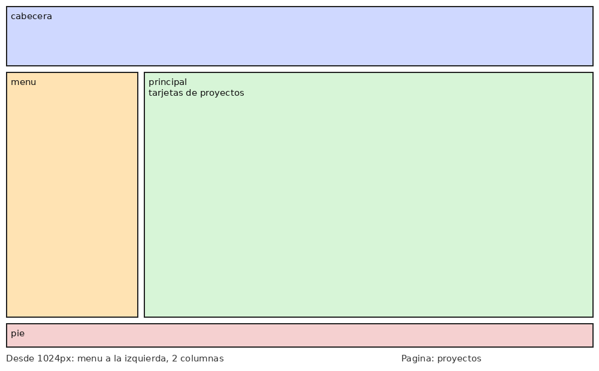
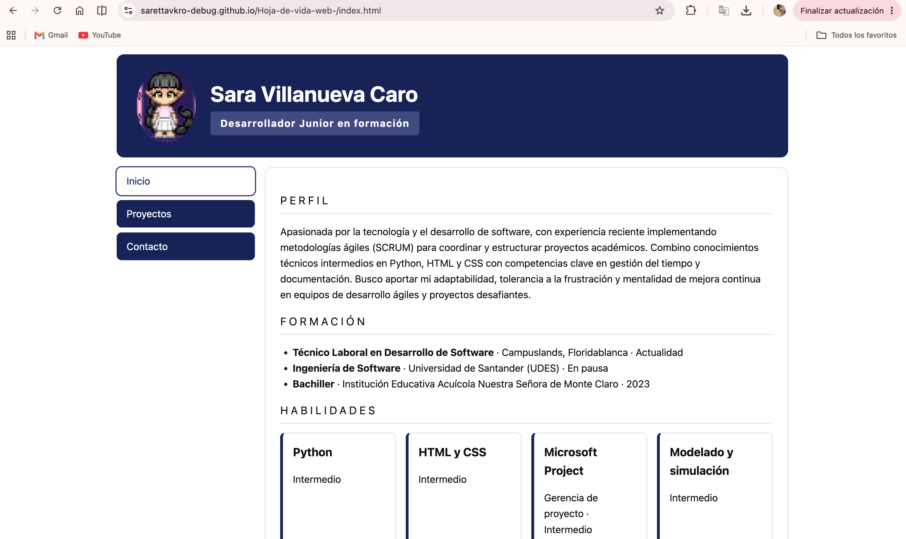

# Hoja de vida web · Sara Villanueva Caro

Sitio personal con mi hoja de vida, mis proyectos y mi información de contacto.

**Sitio publicado:** https://sarettavkro-debug.github.io/Hoja-de-vida-web-/

## Páginas
- `index.html`: hoja de vida
- `proyectos.html`: proyectos
- `contacto.html`: contacto

## Mockups
Áreas usadas en `grid-template-areas`: `cabecera`, `menu`, `principal`, `pie`.

### Hoja de vida

 

### Proyectos

 

### Contacto

 

## Capturas del sitio publicado
Como se ve desde el celular:
 

 
Como se ve desde el portatil:
 

## Breakpoints
- Base (celular): todo en una columna; las áreas van apiladas (cabecera, menu, principal, pie) y el menú es vertical.
- Desde 600px: la cabecera pasa a fila con el avatar al lado del nombre y el menú se vuelve horizontal.
- Desde 1024px: el diseño pasa a dos columnas; el menú queda a la izquierda y el contenido a la derecha.

## Cómo lo publiqué
1. Creé una cuenta en GitHub y un repositorio público llamado `hoja-de-vida`.
2. Subí los archivos (index.html, styles.css y las carpetas img, mockups y capturas).
3. En Settings → Pages elegí "Deploy from a branch", la rama `main` y la carpeta `/ (root)`.
4. Esperé unos minutos y abrí el enlace que GitHub me dio.

## Fuentes consultadas
- Documentación oficial de GitHub Pages: https://docs.github.com/es/pages

